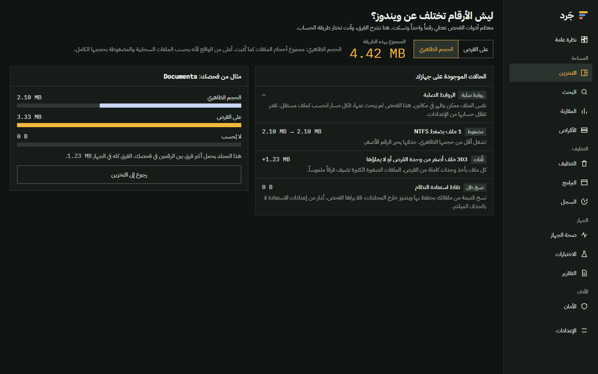
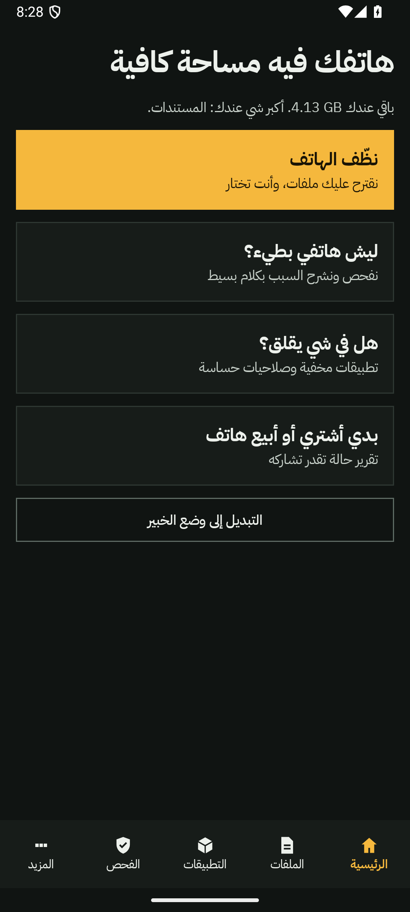
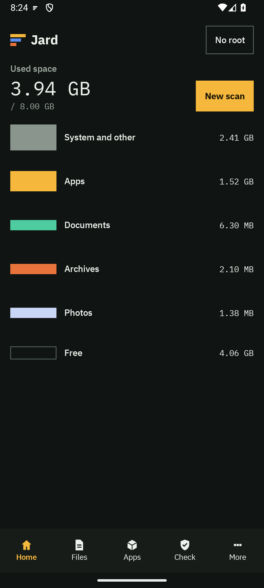
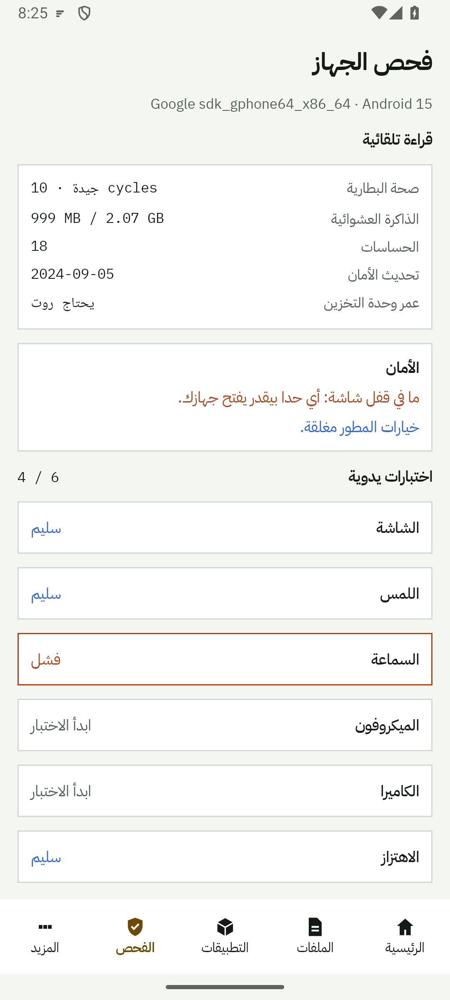

<p align="center">
  
</p>

<p align="center">
  <a href="https://github.com/mahmoudteirdev/jard/actions/workflows/ci.yml"></a>
  
  
  
  
</p>

<div dir="rtl">

**جَرد** بيفحص قرصك أو هاتفك وبيوريك وين راحت المساحة، وبيشرح كل رقم بكلام واضح وصادق.
- **الحجر الصحي الآمن:** ما يتم تنظيفه لا يُحذف فوراً بل ينتقل لحجر مؤقت 30 يوماً مع إمكانية التراجع الكامل.
- **فحص MFT فائق السرعة لنظام ويندوز:** قراءة جدول الملفات الرئيسي مباشرة لفحص مئات آلاف الملفات خلال ثوانٍ.
- **ذكاء اصطناعي محلي فائق الخفة (On-Device AI):** استعلام باللغة الطبيعية (عربي / English) وتنبؤ رياضي زمني بموعد نفاد المساحة وسرعة الاستهلاك بدون إرسال أي حرف لخوادم خارجية وبدون إنترنت نهائياً.
- **صائد مخلفات المطورين (Dev Bloat):** كشف مجلدات `node_modules` و `target` والبيئات الافتراضية للمشاريع الخاملة.
- **فاحص عمر الذاكرة (Flash Wear):** قراءة معايير S.M.A.R.T وسجلات نواة لينكس لشريحة التخزين مع اختبار سرعة حقيقي.
- **صائد الملفات المهجورة (Ghost Files):** كشف مثبتات البرامج والأرشيفات التي فُتحت لمرة واحدة منذ تنزيلها.
- **عربي أولاً:** مصمم بواجهة عربية أصلية بالكامل (RTL) مع مطابقة تامة 100% للغة الإنجليزية، وبلا أي صلاحية إنترنت على الأندرويد.

</div>

## About

```yaml
name: Jard (جَرد)
what: A disk analyzer and cleaner for Windows and Android
languages: [Arabic (right-to-left, first), English]
promises:
  - Nothing is deleted straight away: it moves to a 30-day quarantine, with undo
  - Protected system paths are refused, whatever is asked
  - Three numbers per folder: apparent size, size on disk, and what isn't counted
  - No invented "health scores": readings as the system reports them
  - Android has no internet permission, so it can't send anything anywhere
status: Version 0.1.3 (Resizable split layout, expandable hierarchical tree & nested treemap)
```

## Download

The latest version is on the [releases page](https://github.com/mahmoudteirdev/jard/releases/latest).

| You have | Get |
|---|---|
| Windows | `Jard_..._x64-setup.exe`, or the portable `.zip` |
| Android 8 or newer | `Jard_..._android.apk` |

The Windows files have no code-signing certificate yet, so Windows may warn about an unknown publisher. To check a download, compare its fingerprint with `SHA256SUMS.txt` on the same page.

## Screens

<p align="center">
  
</p>
<p align="center">
  
  
  
</p>

## What it does

**Windows**

- Fast scan of any drive or folder, with a treemap, sunburst visualization, and a paged folder list
- On-Device AI: Natural Language Storage Query parser (sub-50ms, zero cloud) and predictive time-series storage depletion forecasting with burnout velocity rate (+MB/day)
- Direct raw volume `$MFT` reading for NTFS drives, indexing hundreds of thousands of files in seconds
- Developer Bloat Cleaner: hunts abandoned projects (Node, Rust, Python, Gradle, Flutter) and quarantines build/cache folders (`node_modules`, `target`, `.venv`, `build`) with reinstall commands
- Ghost Files Hunter: detects stale installers, disk images, and archives (>30 days old) that were opened once or forgotten
- Cleanup suggestions: large, old and temporary files, exact content duplicates, similar photos, and program leftovers
- A safe 30-day quarantine with reversible undo, and administrator rights asked for one operation at a time
- Search, scan comparison, and a screen explaining why the numbers differ from File Explorer
- Real SSD/NVMe S.M.A.R.T telemetry: wear percentage, operating hours, temperature, and read/write error counts
- Startup programs, open ports, disk benchmark, CSV and PDF reports, scheduled scans, and command palette (`Ctrl+K`)
- Signed updates, only if you say yes, with no network before that

**Android**

- Beginner and expert modes, with a plain "what is this?" for files and folders
- On-Device AI: Natural Language Search and predictive storage exhaustion countdown with zero internet permission
- Flash Storage Wear & Health: direct Linux kernel sysfs inspection for eMMC/UFS health and lifetime estimates, paired with real sequential write/read speed benchmarks
- Ghost Files Hunter: finds stale APKs, archives, and documents in Downloads that were downloaded over a month ago and never opened
- 7-day battery charging history with daily counts, logged via hardware broadcast events without any persistent background service
- Responsive Tablet Layout: two-pane master-detail view with adaptive vertical navigation rail on larger screens (>= 600dp)
- Files by size and age, duplicates, app sizes, and the same safe 30-day quarantine
- Why the phone is slow, battery, speed test, dead-pixel check, and hands-on hardware tests
- Permissions audit, known trackers inside apps, and data use per app
- A used-phone report as text or PDF, a guest mode that wipes itself, and a device log for shops
- Widgets, alerts when nearly full, and a weekly scan
- Verified Shizuku and root integration: access to `Android/data`, real cache clearance, and full audit command logging

## Tools

<p>
  &nbsp;
  &nbsp;
  &nbsp;
  &nbsp;
  &nbsp;
  &nbsp;
  &nbsp;
  &nbsp;
  
</p>

| Folder | What's in it |
|---|---|
| `crates/jard-scan` | The scan engine: flat size tree, duplicates, similar photos, saved results |
| `crates/jard-clean` | The quarantine and the protected-path rules |
| `crates/jard-license` | Offline activation: signed, device-bound files |
| `apps/desktop` | The desktop app: Tauri, React and TypeScript |
| `apps/android` | The Android app: Kotlin and Compose, sharing only design tokens with the desktop |
| `design` | The developer handoff and the design tokens |

## Build it

You need Rust, Node with pnpm, and for Android, Android Studio.

```bash
# Tests for the engines and the desktop shell
cargo test --workspace

# Desktop installer. The result is in target/release/bundle
cd apps/desktop
pnpm install
pnpm tauri build

# Desktop portable zip
pnpm build:portable

# Android debug APK. On Windows, run this from Git Bash
cd ../android
./gradlew :app:testDebugUnitTest :app:assembleDebug
```

Every push to `main` builds both apps on GitHub, and a version tag publishes a release. See [`docs/RELEASING.md`](docs/RELEASING.md). Building a signed release needs your own keys, and activation files need your own license key. None of them are in this repository.

## Status

| Area | State |
|---|---|
| Windows | Built and tested (NTFS MFT, Dev Bloat Cleaner, Ghost Files, S.M.A.R.T telemetry) |
| Android | Core tested on physical Galaxy A51 (Android 13) and S9 (Android 10), all screens verified on Android 15 emulator |
| Shizuku & Root | Built and fully verified on physical hardware (Galaxy A51) with real access granted, folder sizing, and cache clearance |
| Tablet & Battery Chart | Built: adaptive navigation rail, two-pane layout, and 7-day battery charging history |
| Dev Bloat & Ghost Files | Built & tested across both desktop and mobile with 100% Arabic and English translation parity |
| macOS and Linux | Code and settings exist, not yet built or run |

The full spec and the decisions behind it are in [`design/HANDOFF.md`](design/HANDOFF.md), in Arabic.

## License

All rights reserved. The code is public to read, and no license is granted to use, copy or distribute it. The IBM Plex fonts are under the SIL Open Font License, and the Shizuku API library is under MIT. The full list and texts are on the About screen. See also the [privacy policy](docs/PRIVACY.md).
